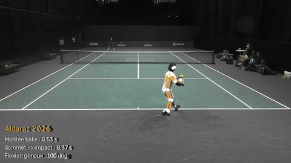
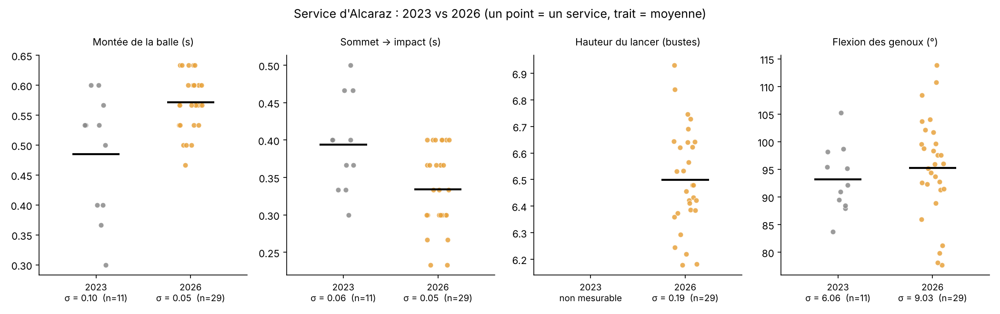

# Analyse du service de Carlos Alcaraz par vision par ordinateur

Comparer le service d'Alcaraz **avant** (2023) et **après** (2026) ses changements de technique, à partir de simples vidéos d'entraînement, sans capteur ni caméra spécialisée.



## Contexte

Alcaraz a modifié son service début 2025 (geste plus fluide, sans temps d'arrêt), puis à nouveau début 2026 (préparation inspirée de Djokovic). Les analyses publiées comparent des images à l'œil. Ce projet cherche à **mesurer** ces changements : rythme du geste, régularité du lancer, hauteur de la balle, flexion des genoux.

## Méthode

| Étape | Script | Rôle |
|---|---|---|
| 1 | — | Découpe des vidéos d'entraînement en clips d'un service (11 en 2023, 33 en 2026) |
| 2 | `src/01_detection.py` | Test de l'estimation de pose (YOLO11-pose, 17 articulations) sur un clip |
| 3 | `src/02_extraction_keypoints.py` | Suivi de toutes les personnes (ByteTrack), sélection automatique du serveur, export des articulations image par image |
| 4 | `src/03_detection_balle.py` | Détection de la balle (YOLO11), filtrage par zone du lancer et suppression des balles immobiles |
| 5 | `src/04_mesures.py` | Calcul des mesures par service et résumé par année |
| 6 | `src/05_visualisation.py` | Graphique de comparaison et vidéos annotées |

Points techniques notables :

- **Sélection du serveur** : la plus grande personne de l'image n'est pas toujours le joueur (spectateurs, personnes au bord du cadre). Le script suit chaque personne et retient celle dont les poignets bougent le plus, en écartant les personnes coupées par le bord de l'image et en recollant les morceaux de suivi perdus.
- **Normalisation** : les hauteurs sont exprimées en « bustes » (distance épaules-hanches), ce qui rend comparables des vidéos filmées avec des zooms différents.
- **Balles parasites** : les balles posées au fond du court sont éliminées car elles restent immobiles d'une image à l'autre.

## Résultats



Comparaison sur 11 services de 2023 et 29 services de 2026 (entraînement en salle) :

| Mesure | 2023 | 2026 |
|---|---|---|
| Montée de la balle (s) | 0,48 (σ 0,10) | 0,57 (σ 0,05) |
| Sommet → impact (s) | 0,39 (σ 0,06) | 0,33 (σ 0,05) |
| Hauteur du lancer (bustes) | non mesurable | 6,50 (σ 0,19) |
| Flexion des genoux (°) | 93 (σ 6) | 95 (σ 9) |

- **Lancer plus régulier en 2026** : l'écart-type de la durée de montée de la balle est divisé par deux.
- **Geste plus enchaîné** : la frappe intervient plus tôt après le sommet du lancer.
- **Flexion des genoux** comparable entre les deux périodes.

## Limites

- **Angles de caméra différents** entre 2023 (de derrière, en hauteur) et 2026 (de côté) : seules les mesures temporelles et normalisées sont comparées ; la hauteur d'impact n'est pas retenue.
- **Précision temporelle** limitée à 1/30 s (vidéos à 30 images/s), visible sous forme de paliers sur le graphique.
- **Sommet du lancer hors cadre** sur 9 services de 2023 sur 11.
- **Échantillon réduit** en 2023 (11 services) : les écarts sont indicatifs, pas statistiquement établis.

## Installation et utilisation

```
python -m venv .venv
.venv\Scripts\activate
pip install -r requirements.txt
```

Placer les clips dans `data/raw/<annee>/`, puis lancer les scripts dans l'ordre :

```
python src/02_extraction_keypoints.py
python src/03_detection_balle.py
python src/04_mesures.py
python src/05_visualisation.py
```

Les vidéos sources (entraînements publiés sur YouTube) ne sont pas incluses dans ce dépôt pour des raisons de droits.

## Suite du projet

Appliquer le même pipeline à mes propres services (filmés au téléphone) pour mesurer ma régularité et la comparer à celle d'Alcaraz.

## Stack

Python · Ultralytics YOLO11 (pose et détection) · ByteTrack · OpenCV · pandas · matplotlib
